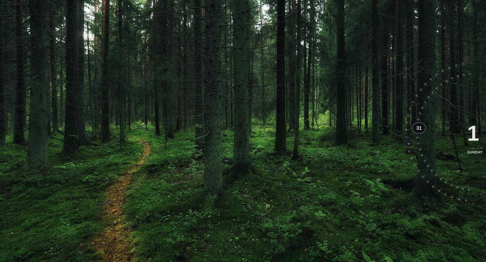
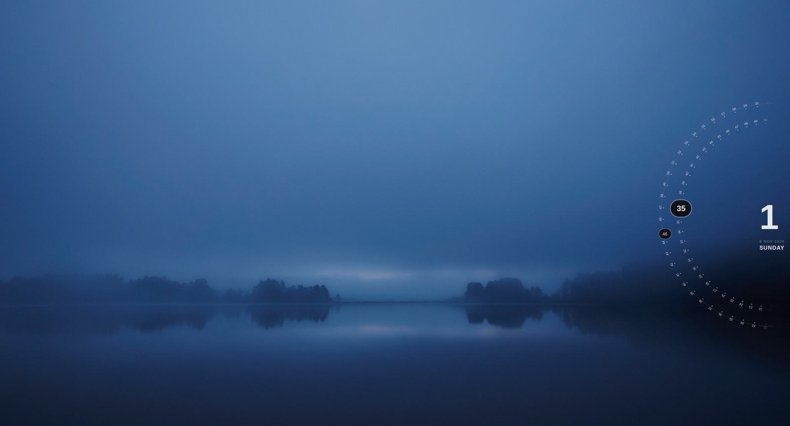
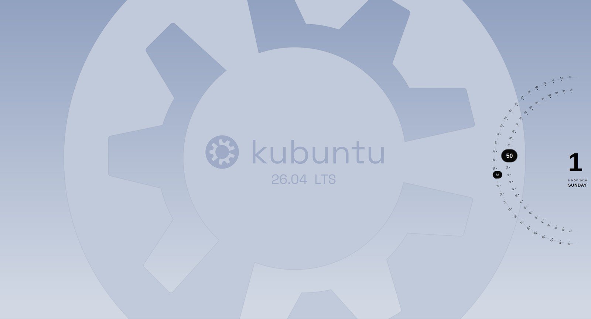

<h1 align="center">Kronos for Plasma</h1>

<p align="center">
  <strong>A Plasma 6 port of <a href="https://github.com/MASH2RAFI/omarchy-kronos">Kronos</a> — the orbital wallpaper clock by <a href="https://github.com/MASH2RAFI">MASH2RAFI</a>.</strong>
</p>

<p align="center">
  
  
  
  <a href="LICENSE"></a>
</p>

<p align="center"></p>

<p align="center">
  <em>Running as a Plasma 6 desktop widget on Kubuntu 26.04 (Wayland).</em>
</p>

---

**Every pixel you see was designed and written by [MASH2RAFI](https://github.com/MASH2RAFI).**
The clock, the layout engine, the dial geometry and the ring shader are all
their work, published as [omarchy-kronos](https://github.com/MASH2RAFI/omarchy-kronos).

That shader is the clever bit: each ring's 60 dots and labels are rasterised
**once** into a texture, and a fragment shader rotates that texture and applies
a baked world-angle alpha lookup in a **single draw call**. No offscreen pass,
no per-frame raster, no texture upload. Per tick the CPU updates two rotation
uniforms and nothing else.

This repository contains **no redesign and no rewrite** — it is a host swap.
Upstream targets [Omarchy](https://omarchy.org), where Kronos runs as a
Quickshell layer-shell surface driven by Hyprland IPC. This port runs the same
renderer, unmodified, as a native KDE Plasma 6 plasmoid.

Nine of upstream's files are used **verbatim**. The only change applied to any
of them is a single import line, required because Qt 6 will not resolve a dotted
module import from a subdirectory:

```diff
-import qs.Commons
+import "qs/Commons"
```

[`PORTING.md`](PORTING.md) documents, file by file, exactly what is theirs and
exactly what was added here.

If you run Omarchy or Hyprland, **use [the original](https://github.com/MASH2RAFI/omarchy-kronos)** — it is the real thing and this port has nothing to offer you.

**How this port was made:** by [Astr0kreep](https://github.com/Astr0kreep)
working with Claude Opus 5 (Anthropic) in Claude Code. Commits carry a
`Co-Authored-By` trailer to that effect, the same way upstream records its own
assisted commits.

This project is not affiliated with or endorsed by MASH2RAFI.

---

## Preview

The default **contrast** ring mode draws against the theme background, so the
dial stays legible whatever the wallpaper is doing — including inverting to
dark on a light desktop.

| Busy dark wallpaper | Minimal dusk | Light wallpaper |
| --- | --- | --- |
|  |  |  |
| Rings hold up over clutter | Hour and dial over flat tones | Contrast mode flips to **dark** |

## Requirements

- KDE Plasma 6 (developed against 6.6)
- Qt 6 (developed against 6.10)
- Wayland or X11 — developed and tested on Wayland

Optional, but it is the intended look:

- **JetBrainsMono Nerd Font** for the 00–59 ring tick labels
- **Liberation Sans** for the hour numeral and date block

The font is *not* bundled — it carries its own licensing. Install it yourself:

```bash
# Ubuntu/Debian — user-level, no sudo
mkdir -p ~/.local/share/fonts/JetBrainsMonoNerd /tmp/jbm
curl -fL -o /tmp/JetBrainsMono.tar.xz \
  https://github.com/ryanoasis/nerd-fonts/releases/latest/download/JetBrainsMono.tar.xz
tar -xJf /tmp/JetBrainsMono.tar.xz -C /tmp/jbm
cp /tmp/jbm/JetBrainsMonoNerdFont-*.ttf ~/.local/share/fonts/JetBrainsMonoNerd/
fc-cache -f ~/.local/share/fonts
```

Without it the labels fall back to your system mono font — readable, just not
the upstream look.

## Install

```bash
git clone https://github.com/Astr0kreep/kronos-plasma.git
cd kronos-plasma
kpackagetool6 --type Plasma/Applet --install org.kronos.clock
```

Then right-click your desktop → **Add Widgets** → search **Kronos**.
If it does not appear, refresh the catalog with `plasmashell --replace &`.

Upgrade in place:

```bash
kpackagetool6 --type Plasma/Applet --upgrade org.kronos.clock
```

Remove:

```bash
kpackagetool6 --type Plasma/Applet --remove org.kronos.clock
```

## Configuration

Right-click the widget → **Configure Kronos Clock**. Three tabs:

| Tab | Covers |
| --- | --- |
| **General** | Position, layout style, ring colour mode, what to show, edge margin, low-power mode, ring renderer |
| **Rings** | Diameter, spacing, arc degrees, opacity, rotation offset, tick label size and colours |
| **Components** | Per-element sizes, fonts, colours, capsule angle/radius offsets, hour and date nudges |

### Placement is not `position`

On Omarchy, `position` anchored the layer surface to a screen edge and the
compositor placed it. On Plasma a desktop widget is **free-floating — you drag
it where you want it**, and Plasma remembers.

So here, `position` controls only the *internal composition*: which way the arcs
curve, where the hour sits relative to the rings, where the capsules land. To
move the clock on screen, drag it.

### Rendering

`shader` (default) rotates a cached ring texture on the GPU. `canvas` repaints
every tick — slower, but a safe fallback. The package ships upstream's
precompiled `ringmask.frag.qsb`, which loads as-is on Qt 6.10, so no
`qt6-shadertools` and no shader rebuild is needed. If the shader ever fails to
load, `RingCanvas.qml` falls back to the canvas renderer on its own.

## Known limitations of this port

- **Ring tick is capped at 60 Hz.** Upstream reads each monitor's refresh rate
  from Hyprland IPC. QML's `Screen` attached property exposes no equivalent, so
  this is hardcoded. On a high-refresh display the rings still animate, just at 60.
- **Multi-monitor is lightly tested.** One instance per screen works the way any
  plasmoid does, but upstream's per-monitor scaling and `Show on primary/external`
  modes were host features and are not ported.
- Upstream's own settings panel, bar widget and `shell.json` integration are
  replaced by Plasma's native configuration — see `PORTING.md`.

## License

[MIT](LICENSE), as upstream. The original copyright notice is retained in full
and ships inside the package.

```
Copyright (c) 2026 MASH2RAFI            (original work)
Copyright (c) 2026 astr0kreep           (Plasma 6 port)
```
